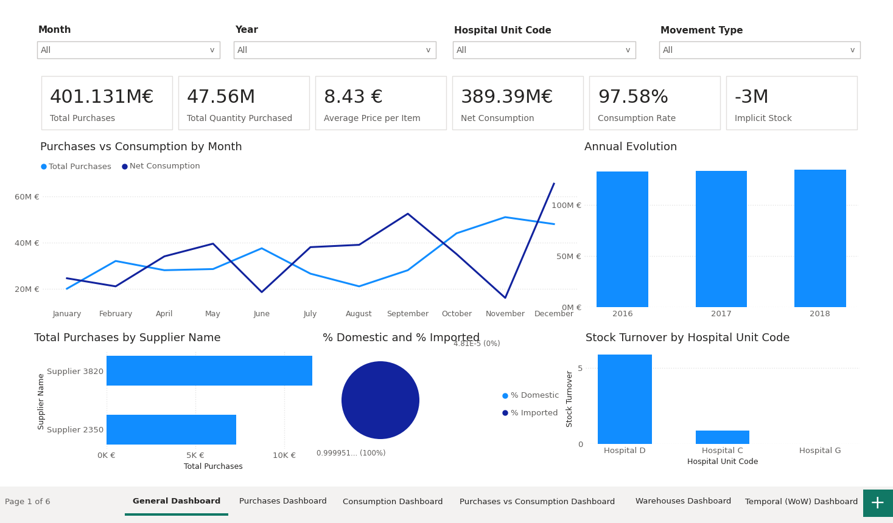
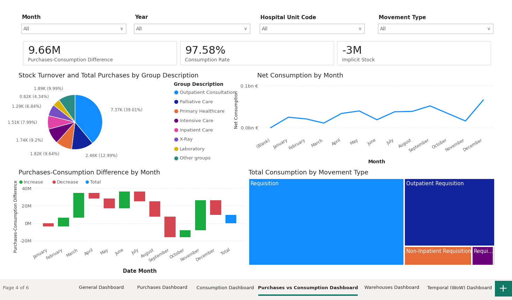

# PharmaGlobal BI Solution

An end-to-end Business Intelligence solution for a hospital supply chain. It analyses **purchases from suppliers** and **consumption across hospital units** using the Microsoft BI stack (SSIS, SSAS, Power BI).



## Architecture

```
Raw files -> SSIS (ETL) -> SQL Server staging -> SSAS Tabular model -> Power BI dashboards
```

| Layer | What it does | Folder |
|-------|--------------|--------|
| **SSIS** | Loads raw files (warehouses, articles, cost centres, suppliers, purchases, consumption) into a SQL Server staging database. Foreach loops load the purchase and consumption files in batches. | `Projeto SSIS/` |
| **SSAS** | Star-schema tabular model with two fact tables (`fCompras`, `fConsumos`) and dimensions for suppliers, articles, warehouses, cost centres, hospital units, countries and a calendar. | `Projeto SSAS/` |
| **Power BI** | Six-page report built on the model. | `Projeto Power BI/` |

## Dashboards

| Page | Focus |
|------|-------|
| General | Overall KPIs |
| Purchases | Spend by supplier, article and country |
| Consumption | Usage by cost centre and hospital unit |
| Purchases vs Consumption | Comparison of what is bought against what is used |
| Warehouses | Stock movement by warehouse |
| Temporal (WoW) | Week-over-week trends |




## Data model


## Tools

SQL Server Integration Services (SSIS) | SQL Server Analysis Services (SSAS Tabular) | Power BI (DAX) | Visual Studio

## Skills demonstrated

ETL design, star-schema modelling, dimensional analysis, DAX measures, dashboard design.

## How to open

1. Open `Projeto Power BI/proj_On_Premise.pbix` in Power BI Desktop. It needs access to the SSAS model, so the data may not refresh on another machine.
2. Open the `.slnx` solutions in Visual Studio to view the SSIS package and the SSAS model.

## Author

Mbionwu Daniel Chukwuebuka | MSc Engineering and Data Science, UTAD
