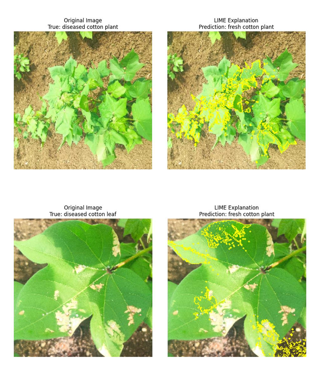

# Cotton Disease Classification with CNNs

Deep learning project that classifies cotton images into **four classes** (diseased leaf, diseased plant, fresh leaf, fresh plant). It compares a baseline CNN with three transfer-learning models and uses **LIME** to explain the predictions.

## Dataset

[Cotton Disease dataset (Kaggle)](https://www.kaggle.com/datasets/janmejaybhoi/cotton-disease-dataset?select=Cotton+Disease). The images are not included in this repository, so download them from the link above.

## Method

- **Preprocessing:** pixel normalisation to [0,1], one-hot labels, augmentation (rotation, zoom, shear, horizontal flip). 128x128 inputs for the baseline CNN, 224x224 for pretrained models.
- **Models:** Baseline CNN, VGG16, ResNet50, EfficientNetB0 (pretrained on ImageNet, then fine-tuned with a lower learning rate).
- **Training:** Adam optimiser, categorical cross-entropy, early stopping, checkpointing, learning-rate scheduling.
- **Explainability:** LIME highlights the image regions that drive each prediction.

## Results

| Model | Training acc. | Validation acc. | Test acc. |
|-------|--------------|-----------------|-----------|
| Baseline CNN | 0.907 | 0.905 | 0.943 |
| VGGNet | 0.982 | 0.980 | **0.981** |
| ResNet | 0.959 | 0.964 | 0.962 |
| EfficientNet | 0.962 | **0.992** | 0.962 |

VGGNet gave the best test accuracy and the most balanced results. EfficientNet had the highest validation accuracy.

## Explainable AI (LIME)

LIME shows the models focus on disease spots, discolouration and texture rather than background.

## Files

| File | Description |
|------|-------------|
| `Daniel_BaselineCNN.ipynb` | Baseline CNN |
| `Daniel_VGG_Net.ipynb` | VGG16 transfer learning |
| `Daniel_ResNet.ipynb` | ResNet50 transfer learning |
| `Daniel_EfficientNet.ipynb` | EfficientNetB0 transfer learning |
| `DEEP LEARNING PROJECT REPORT-3.pdf` | Full project report |

## Tools

Python | TensorFlow / Keras | LIME | Jupyter Notebook

## Author

Mbionwu Daniel Chukwuebuka | MSc Engineering and Data Science, UTAD
